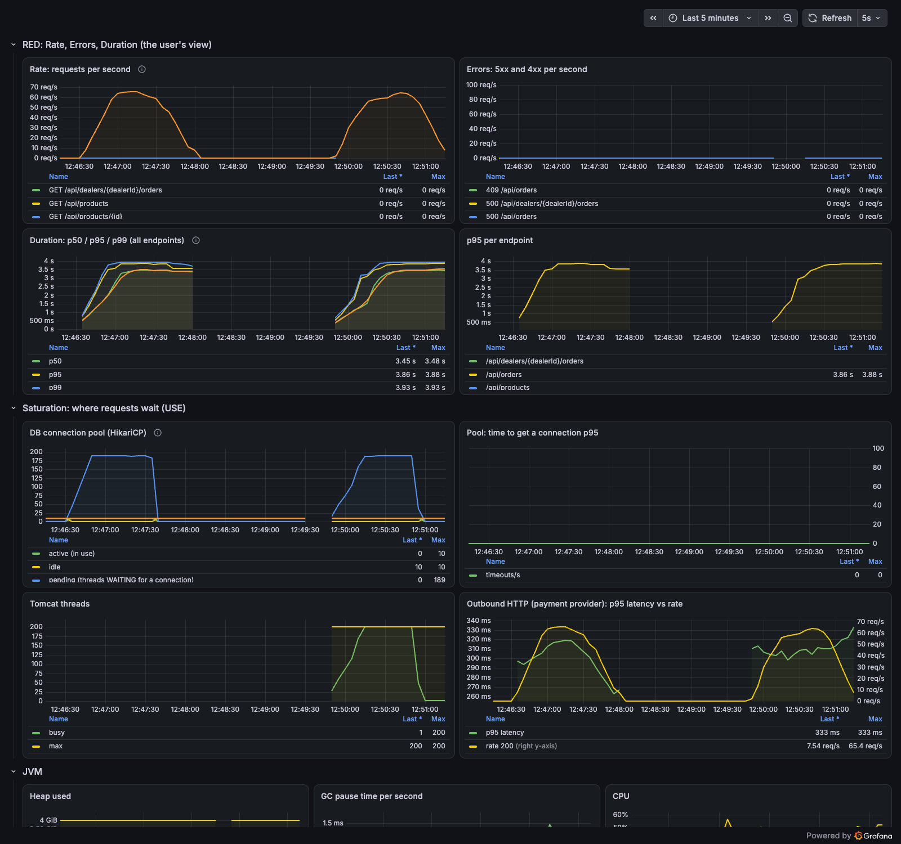

# Scale Lab

A Java learning lab. A realistic dealer ordering system, real load, real monitoring.
The system is **deliberately** naive: missing indexes, N+1 queries, a race condition, an external
call inside a database transaction, an HTTP client with no timeouts. Each mission measures one of
them, fixes it, and proves the fix.

No memorizing: every mission is **predict → measure → 4 steps → change → measure again → one sentence**.

The daily flow (lesson first, then the lab) lives in **dacospace** (http://localhost:4120), which
reads this repo, runs `./lab` commands with live output and embeds the Grafana panels. Everything
also works from the terminal.



## Daily loop

```bash
./lab today              # today's mission
./lab up && ./lab run    # infrastructure + app (run in a separate terminal)
# ... do the mission ...
./lab done 03 "an index's column order must follow the query's WHERE, then ORDER BY"
git add -A && git commit -m "perf: ..."
```

`./lab help` lists every command.

## What's inside

| Part | Purpose | Address |
|---|---|---|
| Spring Boot 4.1 + Java 25 | the app | http://localhost:4180 |
| Postgres 18 + pg_stat_statements | data, slow query analysis | localhost:4184 |
| Grafana + Prometheus + Tempo + Loki + Pyroscope | metrics, traces, logs, profiles | http://localhost:4182 |
| WireMock | fake payment provider, can be slowed down or killed | localhost:4189 |
| k6 | load tests (in Docker) | `./lab load ...` |

Grafana ships a ready dashboard: **Scale Lab** (RED, percentiles, connection pool, Tomcat threads,
outbound HTTP, JVM, k6). Every request is traced in Tempo.

Compose profiles that later missions unlock: `cache` (Redis), `events` (Kafka), `scale` (nginx + 3 instances).

## Content

- `lessons/NN-*.md`: the 10-15 minute reading for mission NN (the concept). All 23 are written.
- `labs/NN-*.md`: the hands-on mission.
- `PROGRESS.md`: the roadmap (23 missions) and your one-line log. Missions 01-10 are written and run
  on the current infrastructure; 11-23 need Redis, Kafka and nginx, which arrive with their missions.

## Domain

- **dealers** (2,000), **products** (20,000, the first 20 are campaign products), **orders**
  (400k), **order_items** (1.2M)
- `GET /api/products?category=...` price list
- `GET /api/products/{id}`
- `POST /api/orders` lower stock, charge payment, write the order
- `GET /api/dealers/{id}/orders` recent orders

## Load scenarios (`load/`)

| Scenario | Simulates |
|---|---|
| `smoke` | does every endpoint answer |
| `morning-rush [RPS]` | 09:00, every dealer opens the price list |
| `orders [RPS]` | steady order traffic, 80% campaign products (hot rows) |
| `dealer-history [RPS]` | the "my recent orders" screen |
| `last-item` (`./lab race`) | 100 dealers try to buy the last 10 items at once |
| `mixed [RPS]` | 30 price list requests/s plus RPS orders/s, p95 per endpoint |
| `double-submit` (`./lab double`) | 50 orders, each sent twice with the same Idempotency-Key |

Results go to `results/` as JSON; `./lab compare <scenario>` compares the last two runs.

## Chaos

```bash
./lab chaos payment slow        # 2 s delay
./lab chaos payment very-slow   # 9 s
./lab chaos payment hang        # 120 s
./lab chaos payment flaky       # every third call returns 503
./lab chaos payment errors      # 503
./lab chaos payment down        # connection reset
./lab chaos payment normal
```

## Working with an AI assistant

The repo carries its own mentor rules: `AGENTS.md` (also read by Claude Code as `CLAUDE.md`) and the
skill `.agents/skills/scale-lab-mentor/SKILL.md` (linked under `.claude/skills/`). Any assistant that
reads them will teach instead of solving: it asks you to predict, runs the measurements with you,
and hints one step at a time. It will not write the fix.

The easiest start is the copy-paste prompt in dacospace: on the Today page for the full setup, and
at the top of every mission page for that mission alone.

## Start at any mission

Missions build on each other, but you do not have to do them in order:

```bash
./lab jump 07
```

creates a branch `mission-07` where missions 01-06 are already solved (from the measured reference
solutions), keeps your current branch, and rebuilds the lab database. Maintainers regenerate those
`start/NN` branches with `scripts/start-branches.sh`.

## Requirements

Docker Desktop, Java 25 (SDKMAN: `sdk install java 25-amzn`), python3. The Maven wrapper is in the
repo. The easiest setup is through dacospace: `pnpm run setup` there checks all of this and clones this
repo next to it.

Ports: app 4180, Grafana 4182, Prometheus 4183, Postgres 4184, OTLP 4188, fake payment provider 4189,
extra app instances 4190-4191 (later missions). The app port can be moved with `LAB_APP_PORT`.

## Reference solutions

The `reference` branch has one commit per solved mission (03-10 so far), each measured on a real
machine. Open it only after you finished a mission, to compare approaches. `git diff main reference --
src/` shows all of it at once, which is exactly what you should not do on day one.

## Rules

- Don't call a fix "fixed" without measuring it. `results/` is the evidence.
- Schema changes only through Flyway migrations.
- One mission = one commit or a few small ones. English, `type: subject`.
